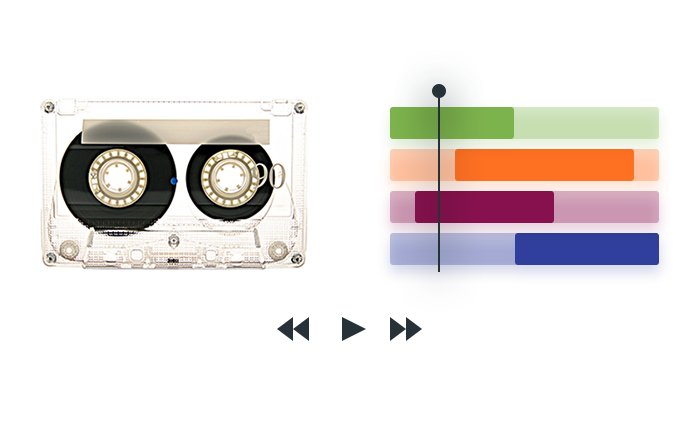
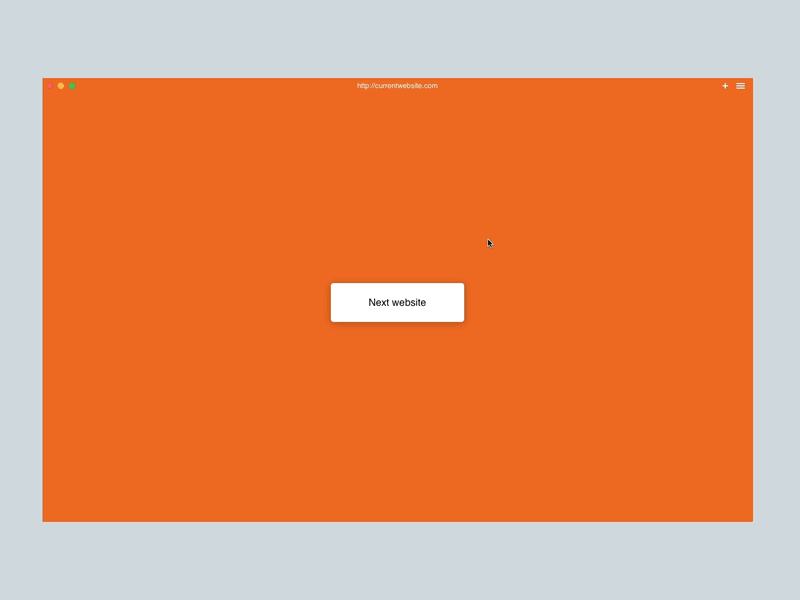
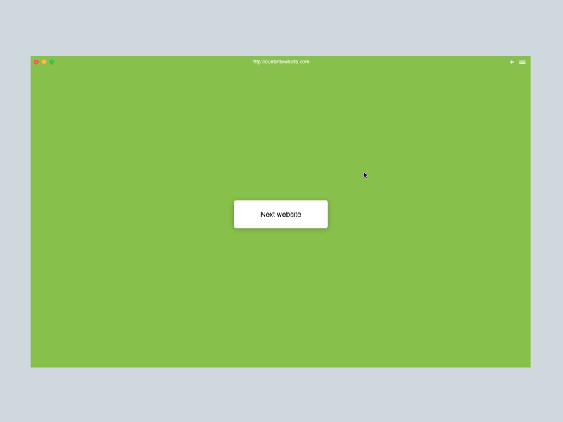
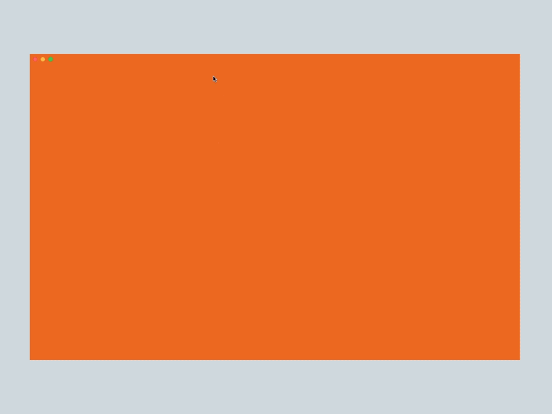

# A Spacial Model for Lossless Web Navigation

> Written by Patryk Adaś, with whom I collaborated on [Browser.html](./browserhtml). Originally published on [freeCodeCamp](https://www.freecodecamp.org/news/lossless-web-navigation-spatial-model-37f83438201d/) on March 29, 2017.

In [my last post](./trails) I described the concept of navigation trails as an evolution of the standard tabbed browsing model.

As a part of the [Browser.html](https://github.com/browserhtml) project, I’m working on a spatial model through various user interactions and animations. This should help users better understand what’s going on and how to navigate the web most effectively.

**Users have developed certain behaviors and expectations we want to build upon. Instead of replacing existing workflows, we want to enhance them.**

### Horizontal movement — going back / forward

When you rewinding a cassette or use a video editing tool, one common interaction model is horizontal movement along a timeline. Browsers use this approach to allow users to go back in their navigation history. But this only allows going backward a single history entry at a time. Shortcuts exist, but they don’t allow _previewing_ past pages.

Even with conventionally lossy navigation history, it’s common to have multiple entries to go backward or forward. Introducing trails will only increase the number of entries.

**We want users to select an arbitrary point in the timeline using familiar interactions.**

<a href="https://youtu.be/reMbtUWeias">YouTube</a>

In our design, a light pull (swipe) from the left allows the user to take a peek at the last history entry. Pulling further unfolds the full trail and reveals the entire history, allowing the user to return to an arbitrary point by releasing on a site.

<a href="https://youtu.be/6e0cGYHJoDQ">YouTube</a>

Pulling past all of the entries switches to a trails overview, as we assume the user wanted to switch to a different website.

<a href="https://youtu.be/uVRWfjceDDg">YouTube</a>

**We want to provide visual clues at the earliest stage of building a trail.** A new website will push the current page to the left, becoming the first in line.

### Vertical movement — switching trail

Mainstream desktop browsers end up overloading the horizontal axis as a way of switching tabs. In contrast, mobile browsers use vertical space for this purpose.

This aligns with long-standing use of vertical ordering in catalogues and as a natural way of arranging todo items.

The average person tends to have either less than eight tabs open, or to add tabs without organization until declaring “tab bankruptcy” and starting fresh.

<a href="https://youtu.be/QH1sOQXvH-k">YouTube</a>

Opening link in the background creates a trail that slides below the currently featured page, once again providing a clue of where new trails end up spatially.

<a href="https://youtu.be/3NxlriMTNnY">YouTube</a>

The bottom of a page is a natural place to provide easy access to the next trail, which is conveniently accessed by scrolling past the end of the page.

<a href="https://youtu.be/AWpbnV41zUE">YouTube</a>

In order for the mental model to work it needs to be applied to all views. The trails overview allows navigation within trails using the same horizontal gestures shown earlier and switching trails using vertical gestures. It provides a navigational map with access to all trails taken while pursuing a specific topic.

### Join us!

We’re currently working on building our first working prototype. If this sounds like fun to you, please check out the [Browser.html](https://github.com/browserhtml/browserhtml) project! You can find our list of [open issues](https://github.com/browserhtml/browserhtml/issues) on GitHub, or come chat with us on our [Slack](https://browserhtml-slackin.herokuapp.com/).
