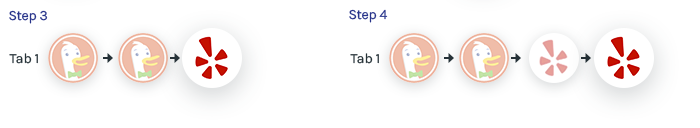
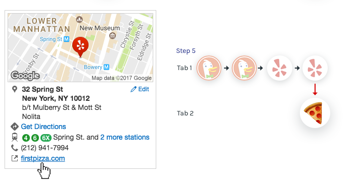
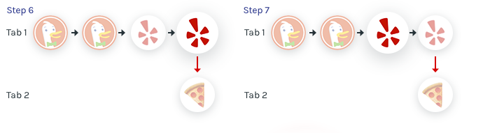
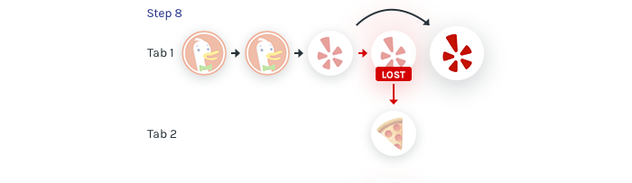
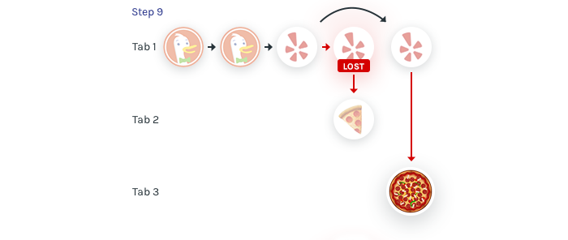
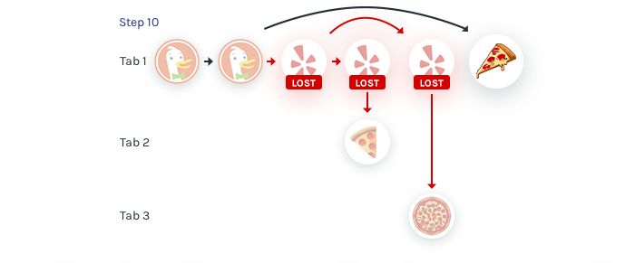
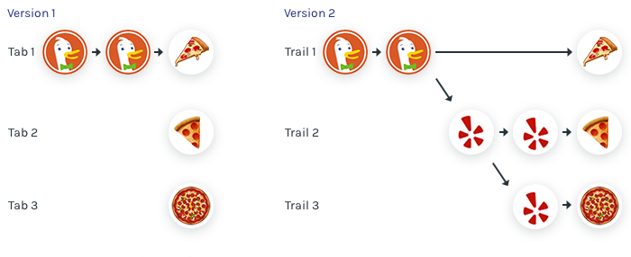
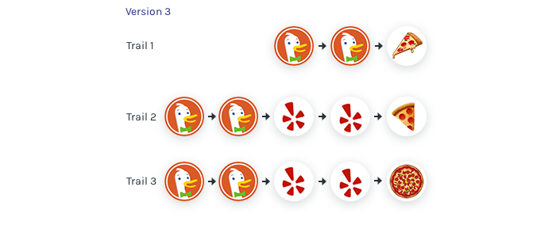

# Lossless Web Navigation with Trails

> Written by Patryk Adaś, with whom I collaborated on [Browser.html](./browserhtml). Originally published on [freeCodeCamp](https://www.freecodecamp.org/news/lossless-web-navigation-with-trails-9cd48c0abb56/) on January 24, 2017.

Since the early 2000’s, the desktop metaphor of tabbed browsing has dominated the way we navigate the web. With [Browser.html](https://github.com/browserhtml/browserhtml), a Mozilla Research project aimed at building a browser user interface built in HTML for nightly builds of [Servo](https://servo.org/), we are experimenting with **evolving the standard tabbed browser towards a model based on _trails_.**

The goal of trails is to construct **not only a window into web content but a narrative of user activity.** Our hope is that our work might help advance the state of browsing closer to the ideal of a tool that _enhances_ our cognitive process, rather than increasing our cognitive load.

To illustrate the kind of scenario we’re thinking about, we’ll introduce you to our friend Nala.

### The search for the perfect pizza

Nala’s scouting out pizza joints. In her traditional, tabbed browser, she sets off with a search _(1)_ that takes her to a page of search results _(2)_.

She follows a link to a list of restaurants on Yelp _(3)_, and checks out a promising pizza joint _(4)_.

External links on Yelp open in separate tabs, so when Nala clicks a link to a restaurant’s website, it starts a new tab _(5)_.

The new tab doesn’t have any history, or any connection to the first tab. **All history about how Nala got to the restaurant’s website is lost!**

The browser’s amnesia compounds as she goes to look at more options: switching back to the first tab _(6)_ and navigating back to the Yelp results _(7)_, she looks for another restaurant.

Now when she selects a new restaurant _(8)_, **part of the current tab’s navigation history is lost as well:**

Clicking an external link to the next restaurant’s website again opens a new tab _(9)_, and again severs the connection from the history that preceded it.

To look at the results of her initial search results again, Nala goes back a few steps in the history of the first tab and opens another pizza venue directly from there _(10)_.

In this example of a common search scenario, more than a third of the history is lost!

Of course, browsers typically provide tools like history views and “recent tabs” menus, [but none of these presents a narrative that matches the actual course Nala followed.](http://medium.freecodecamp.com/browserhistory-2abad38022b1)

### From tabs to trails

With Browser.html we are prototyping a user interface that tells not just the fragments of Nala’s history that a tabbed browser preserves _(Version 1)_, but all of it _(Version 2)_:

But these trees can easily get intricate. What we think matters most is not where each exploration diverged, but the complete path leading to a result. So that’s what we display to the user _(Version 3)_:

Each row represents a trail from the root of the navigation tree to a result. The benefit is that a trail tells a self-contained story from left to right. On the other hand, duplicates lead to a lot of distracting visual noise. Luckily, that can be removed by focusing on a single trail while folding the others.

### Tabs and trails: the same, but different.

If you ignore the paths leading up to each explored topic, trails are no different from conventional tabs. This is intentional: our goal is to enhance existing user experiences, not to replace them. Users can continue using browsers as they always have. And yet **each navigation trail is a tab that tells a complete story from start to finish.** This provides us with opportunities to explore further enhancements to the user experience. Here are a few we’re considering:

- Sharing not just URLs but entire trails.
- Fading trails as they become irrelevant and eventually moving them off the grid.
- Persisting trails in a form as they were during the visit, so that they can be revisited (offline).
- Allowing annotation of trails so users can record their thoughts while researching a topic.
- Collaborative topic research.
- Optionally opening pages in a new trail.

### The Path To Trails

The idea of visualizing a user’s journey through the web as a trail is by no means a new one. Even seventy years ago, in his landmark [As We May Think](http://www.theatlantic.com/magazine/archive/1945/07/as-we-may-think/303881/) essay popularizing the idea of hyperlinked data, [Vannevar Bush](https://en.wikipedia.org/wiki/Vannevar_Bush) described a “memex machine.” He envisioned this machine would help us collect and share data through a personal library that would help us leave a trail through our research process.

Since then, there have been several attempts to create such a tool, beginning with [Trailmeme](https://www.youtube.com/watch?v=ofArVKb58-Q&t=1s) by [Xerox Trails](http://adsabs.harvard.edu/abs/2010SPIE.7540E..07R). This concept was continued by [Trailblazer](https://www-s.acm.illinois.edu/macwarriors/projects/trailblazer/) by [MacWarriors](https://www-s.acm.illinois.edu/macwarriors/) in 2004, currently followed by [Trailblazer.io](http://www.trailblazer.io). It’s our hope that by connecting the ideas of trails to familiar tabbed idioms, we’ll build on existing workflows and make the idea broadly appealing. And Browser.html serves as a great test-bed for these ideas.

### A Spacial Model

I’m working on a spacial model through various user interactions and animations. This should help users better understand what’s going on and how to navigate the web most effectively.

[You can read more about this here.](./spacial-ui)

### Join us!

We’re currently working on building our first working prototype. If this sounds like fun to you, please come check out the [Browser.html](https://github.com/browserhtml/browserhtml) project! You can find our list of [open issues](https://github.com/browserhtml/browserhtml/issues) on GitHub, or come chat with us on our [Slack](https://browserhtml-slackin.herokuapp.com).
